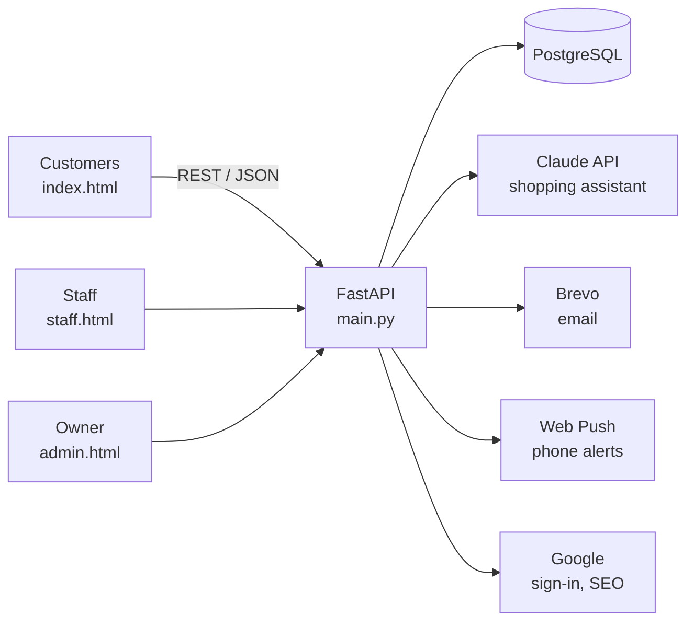

# Bake & Party

**Online store and back-office for a family baking & party supply shop in Givat Shmuel, Israel.**

Customers browse 2,000+ products, order for in-store pickup, track their order live and leave reviews. Staff get a live order board with phone alerts. The owner manages products, hours, staff, pay and customer messaging from one admin panel.

🌐 **Live:** [bakeparty.co.il](https://www.bakeparty.co.il)


---

## Highlights

**For customers**
- Fast, Hebrew (RTL) storefront with live search (typo-tolerant), category navigation, filters and deep links
- Cart and checkout for **in-store pickup**: guest checkout or account, pay at pickup
- **Live order tracking**, with email and phone notifications when the order is ready
- When an item is missing, the customer **picks a substitute from the store**, continues without it, or cancels
- **Reviews from real accounts**: Sign in with Google, profile photo, "verified buyer" badge, optional photo, admin approval
- Installable as an app (PWA), offline page, accessibility menu and accessibility statement
- AI shopping assistant (Claude) that recommends products from the real catalog

**For staff**
- Live order board: sound and push alert on new orders, status flow, missing-item handling, one-tap WhatsApp to the customer
- Time clock with monthly hours and estimated pay

**For the owner**
- Admin panel: products, categories, deals, opening hours, staff and roles, pay, reviews, FAQ, customer messaging
- **Supplier invoice import:** upload a PDF or phone photo; Claude reads the lines (structured JSON output), lines are matched to products by barcode / supplier code / name, prices are proposed by the shop's formula and nothing changes until approved
- **Photo studio:** phone photos are cut out (on-device ML model), straightened, centred on white, with a 16:9 copy for Wolt; photo suggestions by barcode from Open Food Facts
- Wolt integration: OAuth 2.0 (self-service onboarding) with rotating single-use refresh tokens, HMAC-verified order webhook, plus import from a Wolt export and stock comparison
- Notification log showing every email and push, and why any failed
- Audit log of sensitive actions

---

## Tech stack

| Layer | Technology |
|---|---|
| Backend | Python, FastAPI, psycopg2 |
| Database | PostgreSQL |
| Frontend | HTML, CSS and vanilla JavaScript (no build step), Progressive Web App |
| Integrations | Anthropic Claude API (chat, invoice reading), Google Identity Services, Web Push (VAPID), Brevo email API, Wolt Marketplace API |
| Imaging | Pillow, rembg (ONNX background removal), OpenCV |
| Hosting | Railway (auto-deploy from `main`), persistent volume for uploaded images |

## Architecture



## Engineering notes

- **Server-side pricing.** Order totals are always computed from the database and stored as a snapshot on the order; the browser only sends product ids and quantities.
- **Auth.** PBKDF2-SHA256 password hashing, sessions stored as token hashes in the database, roles (`customer` / `employee` / `admin`) re-checked on every request, account lockout and rate limiting, forced password change for staff invites, Google ID tokens verified server-side.
- **Two-factor authentication.** TOTP (RFC 6238) implemented from scratch for staff accounts, with replay protection, single-use hashed backup codes and short-lived login challenges. Password reset by email uses single-use, hashed, 30-minute tokens and never reveals whether an address is registered.
- **Browser hardening.** Content-Security-Policy, HSTS, a CORS allowlist and standard security headers on every response.
- **Backups.** One-click full export for the owner, plus an automatic weekly backup emailed to admins (secrets and session tokens are excluded).
- **Safe rendering.** All user and catalog text is escaped on output; JSON-LD is built with `json.dumps`. Uploaded images are validated by file content, not just extension.
- **Privacy.** Reviews show first name and last-name initial; marketing messages only with explicit opt-in, with a one-click unsubscribe link; per-order notifications don't count as marketing consent.
- **Zero-touch migrations.** The schema is created and migrated idempotently on startup, so every deploy is a plain `git push`.
- **SEO.** Server-rendered product and category pages with schema.org data, a full sitemap and LocalBusiness information.
- **Resilience.** The AI reply parser tolerates malformed model output; email goes through Brevo's HTTPS API (or SMTP where allowed); every notification attempt is logged with its error.

## Project structure

```
├── main.py                  FastAPI app: API, auth, orders, reviews, notifications, SEO pages, AI assistant
├── index.html               Customer storefront (single page, hash routing)
├── staff.html               Staff app: order board and time clock
├── admin.html               Owner's admin panel
├── invoice_ai.py            Reads supplier invoices with Claude; pricing rules
├── photo_studio.py          Product photo clean-up: cut-out, straighten, white background
├── ui-inputs.js             Typeable date/time inputs for the admin and staff screens
├── sw.js                    Service worker: push notifications and offline page
├── manifest*.webmanifest    PWA manifests (store app and staff app)
├── tools/
│   ├── import_data.py       Seed a local database from a Wolt export
│   └── gen_vapid.py         Generate Web Push keys
├── local-dev/               docker-compose for a local PostgreSQL
├── data/                    Sample Wolt export
└── docs/OPERATIONS.he.md    Operations guide (Hebrew)
```

## Running locally

```bash
docker compose -f local-dev/docker-compose.yml up -d        # PostgreSQL on port 5433
pip install -r requirements.txt
python tools/import_data.py data/wolt-export-2026-08-24.xlsx # sample catalog
ADMIN_EMAIL=you@example.com ADMIN_PASSWORD=changeme123 uvicorn main:app --reload
```

Open `http://localhost:8000` (store), `/admin.html` (admin) and `/staff.html` (staff).
All configuration is done through environment variables; see [docs/OPERATIONS.he.md](docs/OPERATIONS.he.md) for the full list and service setup.

## Roadmap

- [x] Online catalog, search and SEO
- [x] Pickup orders with live tracking and staff order board
- [x] Reviews with Google sign-in
- [ ] Delivery orders with distance-based pricing
- [ ] Online payment
- [x] Supplier invoice import with AI, automatic product photos
- [ ] Price and stock sync from the site to Wolt (Wolt sandbox connected)

---

Built by [@naamameray](https://github.com/naamameray), software engineering student.
